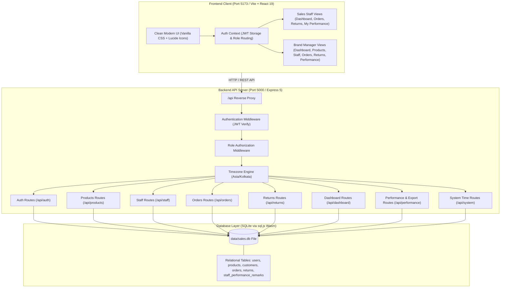
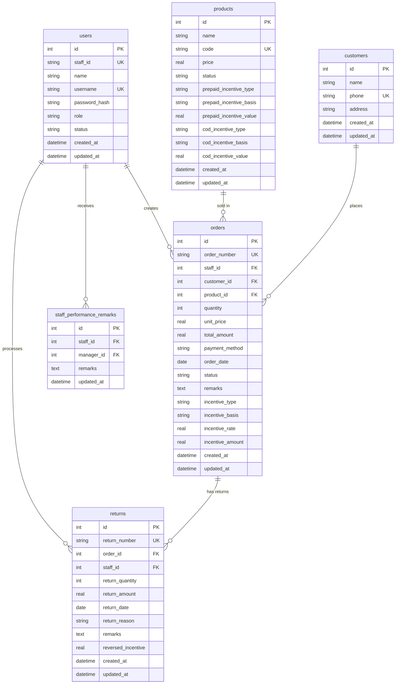

# SalesPulse — Sales Management System (Simplified)

A streamlined, responsive, full-stack Sales Management System designed with strict role-based access for **Sales Staff** and **Brand Managers**. The system is focused entirely on product management, staff management, sales orders, partial and full returns, payment-method-specific staff incentives, and sales performance analytics.

---

## Table of Contents

1. [Project Overview](#1-project-overview)
2. [Key Features](#2-key-features)
3. [User Roles and Permissions](#3-user-roles-and-permissions)
4. [Module Documentation](#4-module-documentation)
5. [Business Rules and Calculations](#5-business-rules-and-calculations)
6. [Technology Stack](#6-technology-stack)
7. [System Architecture](#7-system-architecture)
8. [Project Structure](#8-project-structure)
9. [Prerequisites and Installation](#9-prerequisites-and-installation)
10. [Environment Variables](#10-environment-variables)
11. [Database Overview](#11-database-overview)
12. [Authentication and Security](#12-authentication-and-security)
13. [Testing and Build Verification](#13-testing-and-build-verification)
14. [Deployment](#14-deployment)

---

## 1. Project Overview

SalesPulse is a lightweight, responsive business application built to eliminate fragmented spreadsheets and manual calculations in daily sales operations. It provides a single source of truth for sales transactions, return tracking, and staff incentive distributions.

### Problems Solved
- **Accurate Incentive Calculation**: Automatically calculates commission incentives based on configured rules (fixed vs percentage, per-unit vs per-order) and payment methods (Prepaid vs COD), saving an immutable snapshot with each order.
- **Controlled Return Processing**: Prevents excessive or duplicate product returns by validating against remaining returnable quantities and automatically reversing the appropriate incentive share.
- **Dedicated Manager Observations**: Stores Brand Manager performance observations and coaching remarks in an isolated, dedicated record per staff member.

### Intended Users
- **Sales Staff**: Desk and field sales representatives who create customer orders, process returns, and monitor personal earnings.
- **Brand Managers**: Sales supervisors who manage product pricing, configure incentive rules, manage staff accounts, evaluate team performance, and export sales reports.

---

## 2. Key Features

### Role 1: Sales Staff
- **Personal Dashboard**: Shows self-scoped KPIs (orders, returns, unique customers, products sold, gross sales, net sales, and earned net incentives) with dynamic Chart.js visualizations (sales trend, product distribution, and order status).
- **Streamlined Add Order with Live Incentive Preview**: Fast, distraction-free order creation requiring only **Select Product** and **Quantity** (all other parameters like customer and payment defaults are handled automatically), with instant live preview of earned staff incentives and unique order numbering (`ORD-YYYYMMDD-XXXX`).
- **Controlled Return Processing**: Allows partial or full returns linked to original orders. Enforces server-side validation ensuring return quantity does not exceed remaining returnable quantity, and calculates reversed incentives in real time.
- **My Performance**: Personal incentive audit broken down by payment method and product, along with Brand Manager observation remarks.

### Role 2: Brand Manager
- **Consolidated Dashboard**: High-level KPIs across all sales staff (gross sales, returns, net sales, unique customer reach, total products sold, total incentive payouts, top staff leaderboard, top-selling products, and consolidated revenue trend).
- **Product Management**: Minimal, distraction-free modal to add and edit products focusing strictly on **Product Name**, **Incentive for PREPAID (₹)**, and **Incentive for CASH ON DELIVERY (₹)**, with automated background SKU generation (`PRD-NAME-XXX`).
- **Staff Management**: Create sales staff accounts with auto-generated sequential Staff IDs (`STF-001`, `STF-002`), secure password hashing via `bcrypt`, and activate/deactivate account controls.
- **Orders & Returns Oversight**: Organization-wide visibility into orders and returns with staff filtering, date filtering, and status search.
- **Staff Performance Analysis Table**: Searchable, sortable matrix comparing all staff members across key sales metrics. Includes a detailed drill-down modal, editable manager observations, and direct CSV report export.

---

## 3. User Roles and Permissions

| Module / Action | Sales Staff | Brand Manager | Enforcement Mechanism |
| :--- | :---: | :---: | :--- |
| **View Personal Dashboard** | Yes (Self data only) | Yes (Consolidated / Filtered) | Backend `staff_id` filter in SQL query |
| **Create New Orders** | Yes (Assigned to self) | Yes | Assigned to authenticated user ID |
| **View Orders** | Yes (Own orders only) | Yes (All staff orders) | Backend role check & SQL scoping |
| **Record Returns** | Yes (Own orders only) | Yes (Any order) | Server validation & remaining qty check |
| **View Product Catalog** | Yes (Active products only) | Yes (Active and inactive) | `status = 'active'` filter for staff |
| **Add / Edit Products** | No | Yes | `requireRole('brand_manager')` middleware |
| **Configure Incentive Rules** | No | Yes | `requireRole('brand_manager')` middleware |
| **Staff Account Management** | No | Yes | `requireRole('brand_manager')` middleware |
| **Reset Staff Passwords** | No | Yes | `requireRole('brand_manager')` middleware |
| **Save Manager Observations** | No (Read-only on profile) | Yes | `staff_performance_remarks` table |
| **Export Performance CSV** | No | Yes | `requireRole('brand_manager')` middleware |

---

## 4. Module Documentation

### Dashboard
- **Purpose**: Provides real-time visibility into sales metrics and KPIs.
- **Fields / KPIs**: Total orders, gross sales, returns count, returned value, net sales, products sold, unique customer count, and total net incentives.
- **Relationships**: Aggregates records from `orders`, `returns`, and `customers`.

### Product Management
- **Purpose**: Central catalog for products sold by the brand, defining names and flat commission incentives for Prepaid and COD orders.
- **Fields**: Product Name, Incentive for PREPAID (₹), Incentive for CASH ON DELIVERY (₹), Status (`active` / `inactive`). (SKU Code is auto-generated in the background).
- **Relationships**: Referenced by `orders.product_id`. Inactive products are hidden from new order creation forms while preserving historical order records.

### Staff Management
- **Purpose**: Enables the Brand Manager to administer staff login credentials and monitor active accounts.
- **Fields**: Staff Name, Login Username (unique), Password (hashed), Account Status (`active` / `inactive`). (Sequential Staff ID is auto-assigned upon creation).
- **Relationships**: Foreign key reference in `orders`, `returns`, and `staff_performance_remarks`.

### Orders
- **Purpose**: Captures verified sales transactions placed by sales staff.
- **Fields**: Order Number (e.g., `ORD-YYYYMMDD-XXXX`), Staff ID, Customer ID, Product ID, Quantity, Unit Price, Total Amount, Payment Method (`Prepaid` or `COD`), Order Date, Status (`Confirmed`, `Delivered`, `Pending`, `Cancelled`), Remarks, Incentive Snapshot (Type, Basis, Rate, Amount).
- **Key Actions**: Automatic customer deduplication by phone number, real-time total and incentive estimation before saving, and immutable incentive snapshotting.

### Returns
- **Purpose**: Manages returned items and reverses sales and commissions accurately.
- **Fields**: Return Number (`RET-YYYYMMDD-XXXX`), Order ID, Staff ID, Return Quantity, Return Amount, Return Date, Return Reason, Return Remarks, Reversed Incentive.
- **Key Actions**: Validates that `Return Quantity <= Remaining Returnable Quantity`, calculates proportional incentive reversal, and updates net revenue figures.

### Staff Performance and Reports
- **Purpose**: Consolidates distinct sales, returns, and commission metrics per staff member for appraisal and incentive auditing.
- **Key Actions**: Searchable, sortable columns (Orders, Gross Sales, Returns, Net Sales, Customers, Net Qty, Net Incentive, Remarks), date range filtering, detailed drilldown view with payment and product incentive breakdowns, dedicated manager remarks editing, and CSV download.

---

## 5. Business Rules and Calculations

All formulas are implemented in backend routes (`server/routes/`) and verified against saved database records:

### 1. Net Sales
$$\text{Net Sales} = \text{Gross Order Sales Value} - \text{Total Returned Value}$$

### 2. Net Product Quantity
$$\text{Net Quantity Sold} = \text{Total Ordered Quantity} - \text{Total Returned Quantity}$$

### 3. Customer Counting
$$\text{Total Customers} = \text{COUNT(DISTINCT normalized customer phone numbers)}$$

### 4. Staff Incentive Snapshots
Incentives are computed dynamically at order creation and permanently snapshotted into `orders.incentive_amount`, `orders.incentive_type`, `orders.incentive_basis`, and `orders.incentive_rate`:
- **Fixed per unit**: $\text{Rate} \times \text{Quantity}$
- **Fixed per order**: $\text{Rate}$ (flat amount regardless of quantity)
- **Percentage per unit**: $\frac{\text{Rate}}{100} \times \text{Unit Price} \times \text{Quantity}$
- **Percentage per order**: $\frac{\text{Rate}}{100} \times \text{Total Order Amount}$

### 5. Incentive Reversal on Returns
$$\text{Reversed Incentive} = \frac{\text{Return Quantity}}{\text{Original Order Quantity}} \times \text{Original Snapshot Incentive Amount}$$
$$\text{Net Incentive Earned} = \text{Gross Incentive} - \text{Reversed Incentive}$$

---

## 6. Technology Stack

### Frontend
- **Framework**: React 19.3.1
- **Build Tool**: Vite 8.3.5
- **Icons**: Lucide React
- **Charts & Data Visualization**: Chart.js 4.6.1 and React-Chartjs-2 5.3.1
- **Styling**: Vanilla CSS Design System with CSS variables and responsive layouts

### Backend
- **Runtime**: Node.js (ES Modules)
- **Web Framework**: Express 5.3.0
- **CORS Middleware**: CORS 2.8.6
- **Database Engine**: `sql.js` (SQLite compiled to WebAssembly with automated disk persistence to `data/sales.db`)

### Authentication & Security
- **Token Format**: JSON Web Tokens (`jsonwebtoken` 9.0.3)
- **Password Hashing**: `bcryptjs` 3.0.3 (Salt rounds: 10)
- **Authorization**: Role-based access control middleware (`requireRole`)

---

## 7. System Architecture



---

## 8. Project Structure

```
Sales Analyser/
├── data/
│   └── sales.db                   # SQLite database file (auto-created and persisted)
├── public/
│   ├── favicon.svg                # Application favicon
│   └── icons.svg                  # SVG sprite resources
├── server/
│   ├── routes/
│   │   ├── auth.js                # Login, profile, and demo-switch endpoints
│   │   ├── dashboard.js           # Staff and Brand Manager metric aggregations
│   │   ├── orders.js              # Order creation, customer deduplication, incentive snapshot
│   │   ├── performance.js         # Staff performance table, drilldown, manager remarks, CSV export
│   │   ├── products.js            # Product catalog CRUD, separate prepaid/COD incentives
│   │   ├── returns.js             # Return processing, remaining quantity check, incentive reversal
│   │   ├── staff.js               # Staff creation, ID validation, password reset
│   │   └── system.js              # Timezone status and server clock
│   ├── auth.js                    # JWT token generation and role authorization middleware
│   ├── db.js                      # sql.js SQLite engine, schema initialization, seed data
│   ├── index.js                   # Express 5 server entry point and static build serving
│   └── timezone.js                # Asia/Kolkata business timezone formatting
├── src/
│   ├── components/
│   │   ├── Navbar.jsx             # Top bar with live clock and role portal indicator
│   │   └── Sidebar.jsx            # Dynamic role-based sidebar and quick role switcher
│   ├── context/
│   │   └── AuthContext.jsx        # Authentication context, token storage, demo accounts
│   ├── views/
│   │   ├── manager/
│   │   │   ├── ManagerDashboard.jsx           # Consolidated metrics, sales trend, top staff
│   │   │   ├── ManagerOrders.jsx              # Audit view of all staff orders
│   │   │   ├── ProductManagement.jsx          # Add/edit products, prepaid/COD incentive rules
│   │   │   ├── StaffManagement.jsx            # Add/edit staff, activate/deactivate, reset password
│   │   │   └── StaffPerformanceAnalysis.jsx   # Performance table, drilldown, CSV export
│   │   ├── staff/
│   │   │   ├── StaffDashboard.jsx             # Personal KPI cards, date filters, sales charts
│   │   │   ├── StaffMyPerformance.jsx         # Incentive breakdown by method/product, remarks
│   │   │   ├── StaffOrders.jsx                # Create order with live incentive preview
│   │   │   └── StaffReturns.jsx               # Record returns with reversal calculation
│   │   └── Login.jsx              # Clean login view with one-click demo role switcher
│   ├── api.js                     # Centralized fetch wrapper with JWT header injection
│   ├── App.css                    # Component utilities
│   ├── App.jsx                    # Root view orchestrator and role router
│   ├── index.css                  # Light-themed design system tokens, typography, tables
│   └── main.jsx                   # React DOM entry point
├── dist/                          # Production build output generated by vite build
├── index.html                     # HTML template
├── package.json                   # Dependencies, build scripts, and engine configurations
├── vite.config.js                 # Vite configuration with /api backend proxy
└── README.md                      # Complete system documentation
```

---

## 9. Prerequisites and Installation

1. **Prerequisites**: Node.js (version 18 or newer recommended).
2. **Install Dependencies**:
   ```bash
   npm install
   ```
3. **Start Development Environment**:
   ```bash
   npm run dev
   ```
   - Vite Client: `http://localhost:5173`
   - Express Server: `http://localhost:5000`

---

## 10. Environment Variables

| Variable | Description | Default Value | Required |
| :--- | :--- | :--- | :---: |
| `PORT` | Port number for the Express API server | `5000` | No |
| `JWT_SECRET` | Secret key for signing and verifying JWT tokens | `antigravity_sales_management_secret_key_2026` | Recommended in production |
| `BUSINESS_TIMEZONE` | Timezone used for server clock formatting | `Asia/Kolkata` | No |

---

## 11. Database Overview

The relational database is implemented in SQLite via `sql.js` (WebAssembly) and auto-persists to `data/sales.db`.



---

## 12. Authentication and Security

- **JWT Storage**: Authenticated tokens stored in browser `localStorage`.
- **Role Guarding**: Backend validates role via `requireRole('brand_manager')`.
- **Password Security**: Passwords hashed using `bcrypt` (10 rounds).

### Demo Evaluator Accounts
| Role | Username | Password |
| :--- | :--- | :--- |
| **Brand Manager** | `manager` | `admin123` |
| **Sales Staff** | `rahul` | `staff123` |
| **Sales Staff** | `priya` | `staff123` |
| **Sales Staff** | `vikram` | `staff123` |

---

## 13. Testing and Build Verification

Run production build validation:
```bash
npm run build
```
