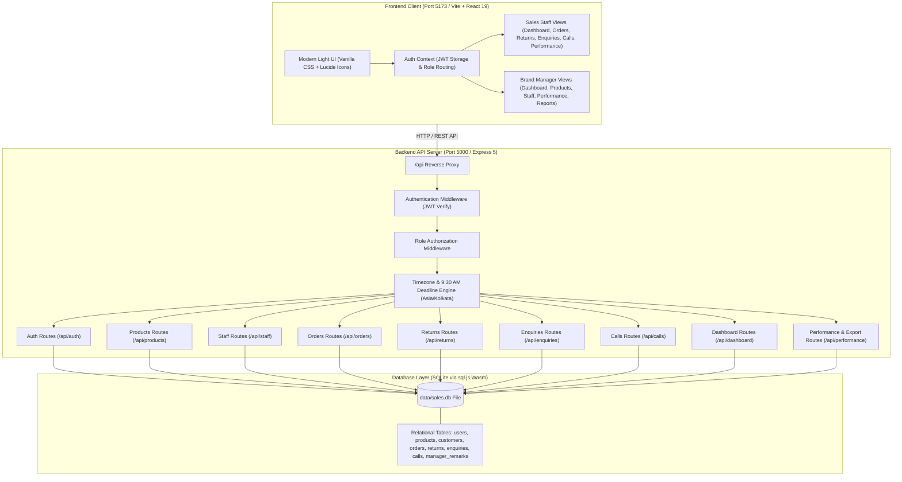
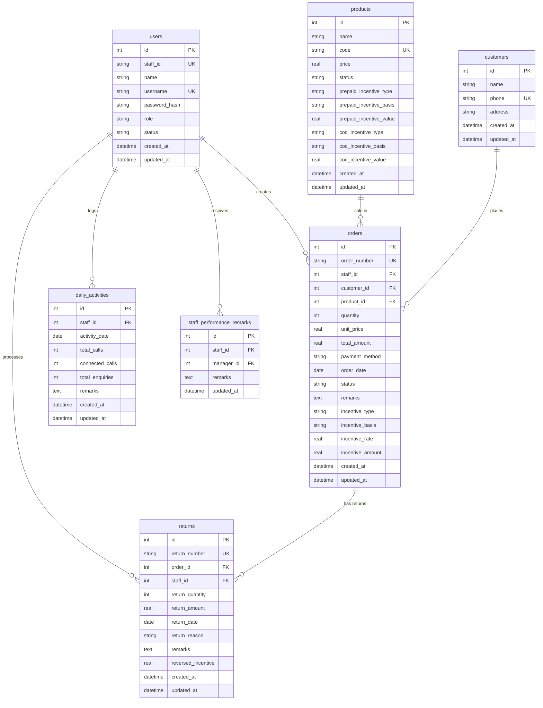

# SalesPulse — Sales Management System (MVP)

A streamlined, responsive, full-stack Sales Management System designed with strict role-based access for **Sales Staff** and **Brand Managers**. The system tracks sales orders, partial and full returns, customer enquiries, manual call logs, product catalogs, payment-method-specific staff incentives, and staff performance metrics.

---

## Table of Contents

1. [Project Overview](#1-project-overview)
2. [Key Features](#2-key-features)
3. [User Roles and Permissions](#3-user-roles-and-permissions)
4. [Module Documentation](#4-module-documentation)
5. [Business Rules and Calculations](#5-business-rules-and-calculations)
6. [Technology Stack](#6-technology-stack)
7. [System Architecture](#7-system-architecture)
8. [Project Structure](#8-project-structure)
9. [Prerequisites and Installation](#9-prerequisites-and-installation)
10. [Environment Variables](#10-environment-variables)
11. [Database Overview](#11-database-overview)
12. [Authentication and Security](#12-authentication-and-security)
13. [Testing and Build Verification](#13-testing-and-build-verification)
14. [Deployment](#14-deployment)
15. [Known Limitations and Future Improvements](#15-known-limitations-and-future-improvements)

---

## 1. Project Overview

SalesPulse is a lightweight, responsive business application built to eliminate fragmented spreadsheets and manual calculations in daily sales operations. It provides a single source of truth for sales transactions, return tracking, customer relationship touchpoints, and staff incentive distributions.

### Problems Solved
- **Accurate Incentive Calculation**: Automatically calculates commission incentives based on configured rules (fixed vs percentage, per-unit vs per-order) and payment methods (Prepaid vs COD), saving an immutable snapshot with each order.
- **Controlled Return Processing**: Prevents excessive or duplicate product returns by validating against remaining returnable quantities and automatically reversing the appropriate incentive share.
- **Daily Activity Accountability**: Enforces a strict **9:30 AM next-day cutoff deadline** (in the configured business timezone, defaulting to `Asia/Kolkata`) for logging customer calls and enquiries, after which past-day records are locked against tampering.
- **Separated Remarks**: Isolates staff order/call/enquiry notes, customer return reasons, and manager performance review observations into separate, dedicated data structures.

### Intended Users
- **Sales Staff**: Field and desk agents who record daily enquiries, log calls, create customer orders, process returns, and monitor personal earnings.
- **Brand Managers**: Sales supervisors who manage product pricing, configure incentive rules, manage staff accounts, evaluate team performance, and export sales reports.

### Current Status
- Fully functional Minimum Viable Product (MVP) with SQLite relational database persistence, authenticated Express REST API, and a custom light-themed React frontend.

---

## 2. Key Features

### Role 1: Sales Staff
- **Personal Dashboard**: Shows self-scoped KPIs (orders, returns, total enquiries, total calls, unique customers, products sold, earned net incentive, and today's summary) with dynamic Chart.js visualizations (sales trend, product distribution, calls vs enquiries, order status, and returns over time).
- **Streamlined Add Order with Live Incentive Preview**: Fast, distraction-free order creation requiring only **Select Product** and **Quantity** (all other parameters like customer and payment defaults are handled automatically), with instant live preview of earned staff incentives and unique order numbering (`ORD-YYYYMMDD-XXXX`).
- **Controlled Return Processing**: Allows partial or full returns linked to original orders. Enforces server-side validation ensuring return quantity does not exceed remaining returnable quantity, and calculates reversed incentives in real time.
- **Daily Activity Logging (Total Counts)**: Simple and efficient daily logging where staff simply submit their total count of calls, connected calls count, and total enquiries count for the day, without needing separate sessions or tedious forms for individual customer calls/enquiries.
- **9:30 AM Cutoff Enforcement**: Rejects past-day daily activity count entries after 09:30 AM the following day in `Asia/Kolkata` time.
- **My Performance**: Personal incentive audit broken down by payment method and product, along with Brand Manager observation remarks.

### Role 2: Brand Manager
- **Consolidated Dashboard**: High-level KPIs across all sales staff (gross sales, returns, net sales, unique customer reach, connected call %, enquiry conversion %, total incentive payouts, top staff leaderboard, top-selling products, and today's staff entry completion tracker).
- **Product Management**: Minimal, distraction-free modal to add and edit products focusing strictly on **Product Name**, **Incentive for PREPAID (₹)**, and **Incentive for CASH ON DELIVERY (₹)**, with automated background SKU generation (`PRD-NAME-XXX`).
- **Staff Management**: Create sales staff accounts with auto-generated sequential Staff IDs (`STF-001`, `STF-002`), secure password hashing via `bcrypt`, and activate/deactivate account controls.
- **Orders & Returns Oversight**: Organization-wide visibility into orders and returns with staff filtering, date filtering, and status search.
- **Daily Activity Audit**: Overview of daily call and enquiry counts logged by each staff member, with real-time connection rate calculations and lock status indicators.
- **Staff Performance Analysis Table**: Searchable, sortable matrix comparing all staff members across key metrics. Includes a detailed drill-down modal, editable manager observations, and direct CSV report export.

---

## 3. User Roles and Permissions

| Module / Action | Sales Staff | Brand Manager | Enforcement Mechanism |
| :--- | :---: | :---: | :--- |
| **View Personal Dashboard** | Yes (Self data only) | Yes (Consolidated / Filtered) | Backend `staff_id` filter in SQL query |
| **Create New Orders** | Yes (Assigned to self) | Yes | Assigned to authenticated user ID |
| **View Orders** | Yes (Own orders only) | Yes (All staff orders) | Backend role check & SQL scoping |
| **Record Returns** | Yes (Own orders only) | Yes (Any order) | Server validation & remaining qty check |
| **Log Daily Activity Counts** | Yes (Before 9:30 AM cutoff) | Yes (Audit & edit) | Timezone engine deadline check |
| **View Product Catalog** | Yes (Active products only) | Yes (Active and inactive) | `status = 'active'` filter for staff |
| **Add / Edit Products** | No | Yes | `requireRole('brand_manager')` middleware |
| **Configure Incentive Rules** | No | Yes | `requireRole('brand_manager')` middleware |
| **Staff Account Management** | No | Yes | `requireRole('brand_manager')` middleware |
| **Reset Staff Passwords** | No | Yes | `requireRole('brand_manager')` middleware |
| **Save Manager Observations** | No (Read-only on profile) | Yes | `staff_performance_remarks` table |
| **Export Performance CSV** | No | Yes | `requireRole('brand_manager')` middleware |

---

## 4. Module Documentation

### Dashboard
- **Purpose**: Provides real-time visibility into sales metrics and KPIs.
- **Fields / KPIs**: Total orders, gross sales, returns count, returned value, net sales, products sold, unique customer count, total enquiries, total calls, connected call %, enquiry conversion %, and total net incentives.
- **Relationships**: Aggregates records from `orders`, `returns`, `daily_activities`, and `customers`.

### Product Management
- **Purpose**: Central catalog for products sold by the brand, defining names and flat commission incentives for Prepaid and COD orders.
- **Fields**: Product Name, Incentive for PREPAID (₹), Incentive for CASH ON DELIVERY (₹), Status (`active` / `inactive`). (SKU Code is auto-generated in the background).
- **Relationships**: Referenced by `orders.product_id`. Inactive products are hidden from new order creation forms while preserving historical order records.

### Staff Management
- **Purpose**: Enables the Brand Manager to administer staff login credentials and monitor active accounts.
- **Fields**: Staff Name, Login Username (unique), Password (hashed), Account Status (`active` / `inactive`). (Sequential Staff ID is auto-assigned upon creation).
- **Relationships**: Foreign key reference in `orders`, `returns`, `daily_activities`, and `staff_performance_remarks`.

### Orders
- **Purpose**: Captures verified sales transactions placed by sales staff.
- **Fields**: Order Number (e.g., `ORD-YYYYMMDD-XXXX`), Staff ID, Customer ID, Product ID, Quantity, Unit Price, Total Amount, Payment Method (`Prepaid` or `COD`), Order Date, Status (`Confirmed`, `Delivered`, `Pending`, `Cancelled`), Remarks, Incentive Snapshot (Type, Basis, Rate, Amount).
- **Key Actions**: Automatic customer deduplication by phone number, real-time total and incentive estimation before saving, and immutable incentive snapshotting.

### Returns
- **Purpose**: Manages returned items and reverses sales and commissions accurately.
- **Fields**: Return Number (`RET-YYYYMMDD-XXXX`), Order ID, Staff ID, Return Quantity, Return Amount, Return Date, Return Reason, Return Remarks, Reversed Incentive.
- **Key Actions**: Validates that `Return Quantity <= Remaining Returnable Quantity`, calculates proportional incentive reversal, and updates net revenue figures.

### Daily Activity (Total Counts)
- **Purpose**: Streamlined single daily logging where staff record their daily totals for customer calls, connected calls, and enquiries without entering individual records.
- **Fields**: Activity Date, Total Calls Count, Connected Calls Count, Total Enquiries Count, Remarks / Notes.
- **Key Actions**: Subject to the **09:30 AM next-day cutoff** in `Asia/Kolkata`. Entries for date $D$ lock automatically at 09:30 AM on date $D + 1$. Computes real-time connection rates and provides an audit history for brand managers.

### Staff Performance and Reports
- **Purpose**: Consolidates distinct sales, returns, and daily engagement activity metrics per staff member for appraisal and commission auditing.
- **Key Actions**: Searchable, sortable columns, date range filtering, detailed drilldown view with payment and product incentive breakdowns, daily activity audit log, dedicated manager remarks editing, and CSV download.

---

## 5. Business Rules and Calculations

All formulas are implemented in backend routes (`server/routes/`) and verified against saved database records:

### 1. Net Sales
$$\text{Net Sales} = \text{Gross Order Sales Value} - \text{Total Returned Value}$$
- **Example**: If an order for ₹4,999 has a partial return of 1 unit worth ₹1,999, the net sales figure is ₹3,000.

### 2. Net Product Quantity
$$\text{Net Quantity Sold} = \text{Total Ordered Quantity} - \text{Total Returned Quantity}$$

### 3. Customer Counting
$$\text{Total Customers} = \text{COUNT(DISTINCT normalized customer phone numbers)}$$
- Customer phone numbers are normalized by stripping non-numeric characters. Multiple orders from the same customer phone number count as **one unique customer**.

### 4. Staff Incentive Snapshots
Incentives are computed dynamically at order creation and permanently snapshotted into `orders.incentive_amount`, `orders.incentive_type`, `orders.incentive_basis`, and `orders.incentive_rate`:
- **Fixed per unit**: $\text{Rate} \times \text{Quantity}$
- **Fixed per order**: $\text{Rate}$
- **Percentage per unit**: $(\text{Unit Price} \times \text{Quantity}) \times \frac{\text{Rate}}{100}$
- **Percentage per order**: $\text{Order Total Amount} \times \frac{\text{Rate}}{100}$
- **Rounding Rule**: Standard 2-decimal banker's rounding (`Math.round(val * 100) / 100`).
- **Audit Immunity**: Editing product prices or incentive configurations in Product Management **never** alters historical order incentive records.

### 5. Return Incentive Reversal
When a return occurs, the incentive to be reversed is computed proportionally:
$$\text{Reversed Incentive} = \text{ROUND}\left(\frac{\text{Return Quantity}}{\text{Original Order Quantity}} \times \text{Original Order Incentive Amount},\, 2\right)$$
$$\text{Net Incentive Earned} = \text{Gross Incentive} - \text{Reversed Incentive}$$

### 6. Call Connection Percentage
$$\text{Call Connection Rate} = \begin{cases} \frac{\text{Connected Calls}}{\text{Total Calls}} \times 100 & \text{if Total Calls} > 0 \\ 0\% & \text{if Total Calls} = 0 \end{cases}$$

### 7. Enquiry Conversion Percentage
$$\text{Enquiry Conversion Rate} = \begin{cases} \frac{\text{Converted Enquiries Linked to Orders}}{\text{Total Enquiries}} \times 100 & \text{if Total Enquiries} > 0 \\ 0\% & \text{if Total Enquiries} = 0 \end{cases}$$

### 8. Daily Activity Deadline (9:30 AM Cutoff)
- **Timezone**: Evaluated strictly in the business timezone (`Asia/Kolkata` / UTC+05:30).
- **Rule**: Daily activity records (calls and enquiries) for date $D$ can only be created or modified until **09:30:00 AM on date $D + 1$**.
- **Locking**: Once the current server time in `Asia/Kolkata` passes 09:30 AM, entries for date $D$ and earlier are locked. The backend returns HTTP `422 Unprocessable Entity`.
- **Exemption**: Order creation and return processing are explicitly **exempt** from this daily cutoff.

---

## 6. Technology Stack

### Frontend
- **Framework**: React 19.3.1
- **Build Tool**: Vite 8.3.5
- **Icons**: Lucide React 1.16.0
- **Charts & Data Visualization**: Chart.js 4.5.1 and React-Chartjs-2 5.3.1
- **Styling**: Modern Vanilla CSS Design System with CSS variables and responsive flexbox/grid

### Backend
- **Runtime**: Node.js v22.19.0 (ES Modules)
- **Web Framework**: Express 5.2.1
- **CORS Middleware**: CORS 2.8.6
- **Database Engine**: `sql.js` (SQLite compiled to WebAssembly with automated disk persistence to `data/sales.db`)

### Authentication & Security
- **Token Format**: JSON Web Tokens (`jsonwebtoken` 9.0.3)
- **Password Hashing**: `bcryptjs` 3.0.3 (Salt rounds: 10)
- **Authorization**: Role-based access control middleware (`requireRole`)

### Tooling
- **Process Orchestration**: `concurrently` 9.2.1

---

## 7. System Architecture



---

## 8. Project Structure

```
Sales Analyser/
├── data/
│   └── sales.db                   # SQLite database file (auto-created and persisted)
├── public/
│   ├── favicon.svg                # Application favicon
│   └── icons.svg                  # SVG sprite resources
├── server/
│   ├── routes/
│   │   ├── auth.js                # Login, profile, and demo-switch endpoints
│   │   ├── calls.js               # Call logging, duplicate check, deadline check
│   │   ├── dashboard.js           # Staff and Brand Manager metric aggregations
│   │   ├── enquiries.js           # Enquiry management, status updates, order linking
│   │   ├── orders.js              # Order creation, customer deduplication, incentive snapshot
│   │   ├── performance.js         # Staff performance table, drilldown, manager remarks, CSV export
│   │   ├── products.js            # Product catalog CRUD, separate prepaid/COD incentives
│   │   ├── returns.js             # Return processing, remaining quantity check, incentive reversal
│   │   ├── staff.js               # Staff creation, ID validation, password reset
│   │   └── system.js              # Timezone status, server clock, 9:30 AM deadline check
│   ├── auth.js                    # JWT token generation and role authorization middleware
│   ├── db.js                      # sql.js SQLite engine, schema initialization, seed data
│   ├── index.js                   # Express 5 server entry point and static build serving
│   └── timezone.js                # Asia/Kolkata business timezone and deadline calculation
├── src/
│   ├── assets/                    # Project visual assets
│   ├── components/
│   │   ├── Navbar.jsx             # Top bar with live IST clock and deadline warning banner
│   │   └── Sidebar.jsx            # Dynamic role-based sidebar and quick role switcher
│   ├── context/
│   │   └── AuthContext.jsx        # Authentication context, token storage, demo accounts
│   ├── views/
│   │   ├── manager/
│   │   │   ├── ManagerDashboard.jsx           # Consolidated metrics, charts, staff activity
│   │   │   ├── ManagerOrders.jsx              # Audit view of all staff orders
│   │   │   ├── ProductManagement.jsx          # Add/edit products, prepaid/COD incentive rules
│   │   │   ├── StaffManagement.jsx            # Add/edit staff, activate/deactivate, reset password
│   │   │   └── StaffPerformanceAnalysis.jsx   # 14-column performance table, drilldown, CSV export
│   │   ├── staff/
│   │   │   ├── StaffCalls.jsx                 # Log calls with outcome & deadline verification
│   │   │   ├── StaffDashboard.jsx             # Personal KPI cards, date filters, 5 charts
│   │   │   ├── StaffEnquiries.jsx             # Enquiries tracking and order conversion
│   │   │   ├── StaffMyPerformance.jsx         # Incentive breakdown by method/product, remarks
│   │   │   ├── StaffOrders.jsx                # Create order with live incentive preview
│   │   │   └── StaffReturns.jsx               # Record returns with reversal calculation
│   │   └── Login.jsx              # Clean login view with one-click demo role switcher
│   ├── api.js                     # Centralized fetch wrapper with JWT header injection
│   ├── App.css                    # Component utilities
│   ├── App.jsx                    # Root view orchestrator and role router
│   ├── index.css                  # Light-themed design system tokens, typography, tables, badges
│   └── main.jsx                   # React DOM entry point
├── dist/                          # Production build output generated by vite build
├── index.html                     # HTML template with Google Fonts (Plus Jakarta Sans, Inter)
├── package.json                   # Dependencies, build scripts, and engine configurations
├── vite.config.js                 # Vite configuration with /api backend proxy
└── README.md                      # Complete system documentation
```

---

## 9. Prerequisites and Installation

### Prerequisites
- **Node.js**: Version `18.0.0` or higher (verified on Node `v22.19.0`).
- **npm**: Version `9.0.0` or higher (verified on npm `10.1.0`).

### Installation Steps

1. **Clone or Open the Repository Directory**:
   ```bash
   cd "c:\Users\HP\Desktop\Sales Analyser"
   ```

2. **Install Dependencies**:
   ```bash
   npm install
   ```

3. **Start Development Server** (Runs both Express backend on port `5000` and Vite frontend on port `5173` concurrently):
   ```bash
   npm run dev
   ```

4. **Access the Application**:
   - Frontend Application: [http://localhost:5173](http://localhost:5173)
   - Backend API: [http://localhost:5000](http://localhost:5000)

### Seed Accounts for Evaluation
The SQLite database automatically initializes on first run and seeds sample records:
- **Brand Manager**:
  - Username: `manager`
  - Password: `admin123`
- **Sales Staff (Rahul Sharma)**:
  - Username: `rahul`
  - Password: `staff123`
- **Sales Staff (Priya Patel)**:
  - Username: `priya`
  - Password: `staff123`

*(Note: The login view and sidebar also feature a one-click demo switcher for seamless role evaluation).*

---

## 10. Environment Variables

The application runs with built-in production-safe defaults and can be customized via environment variables:

| Variable | Description | Default Value | Required |
| :--- | :--- | :--- | :---: |
| `PORT` | Port number for the Express API server | `5000` | No |
| `JWT_SECRET` | Secret key for signing and verifying JWT tokens | `antigravity_sales_management_secret_key_2026` | Recommended in production |
| `BUSINESS_TIMEZONE` | Timezone used to evaluate the 9:30 AM daily activity cutoff | `Asia/Kolkata` | No |

### Example `.env.example`
```env
PORT=5000
JWT_SECRET=your_secure_random_jwt_secret_here
BUSINESS_TIMEZONE=Asia/Kolkata
```

---

## 11. Database Overview

The relational database is implemented in SQLite via `sql.js` (WebAssembly) and auto-persists to `data/sales.db`.



---

## 12. Authentication and Security

- **Authentication Flow**: Users authenticate with a username/staff ID and password at `POST /api/auth/login`. On success, the server issues a signed JWT token containing `id`, `staff_id`, `role`, and `username`.
- **Token Handling**: The token is stored in the browser's `localStorage` under `sales_token` and transmitted in the HTTP `Authorization: Bearer <token>` header for all API requests.
- **Role Isolation**:
  - Middleware `authenticate` verifies token validity and checks that the user account is active in the database.
  - Middleware `requireRole('brand_manager')` ensures Sales Staff cannot create products, create staff, reset passwords, edit manager remarks, or access manager-only views.
  - SQL queries for orders, returns, enquiries, calls, and performance automatically scope data to `staff_id = req.user.id` when invoked by Sales Staff, preventing unauthorized cross-staff data access.
- **Password Security**: Passwords are never stored or returned in plaintext. All passwords are encrypted using `bcryptjs` with a cost factor of 10.
- **Manager Account Protection**: Brand Managers are restricted from modifying other managers' credentials or account states.

---

## 13. Testing and Build Verification

### Build Verification
The frontend production build was verified using Vite:
```bash
npm run build
```
**Output**:
```
vite v8.3.5 building client environment for production...
transforming...
✓ 2049 modules transformed.
rendering chunks...
computing gzip size...
dist/index.html                   0.98 kB │ gzip:   0.52 kB
dist/assets/index-v5SnDXhy.css   12.92 kB │ gzip:   3.16 kB
dist/assets/index-Btcxzu4O.js   555.63 kB │ gzip: 161.01 kB
✓ built in 3.00s
```

### Backend Startup Verification
The backend server and database engine were verified:
```bash
npm run server
```
**Output**:
```
Sales Management System API running at http://localhost:5000
Database seeded successfully!
```

---

## 14. Deployment

### Production Execution
The Express application is configured to serve the pre-built React frontend located in `dist/`:
1. Build the frontend:
   ```bash
   npm run build
   ```
2. Start the production server:
   ```bash
   npm start
   ```
   The application will be accessible directly on `http://localhost:5000`.

### Container or Cloud Hosting
To deploy to services such as Render, Railway, AWS EC2, or Docker:
- Ensure Node.js 18+ is installed.
- Ensure the `data/` directory has write permissions so `data/sales.db` can persist to disk.
- Mount a persistent volume to `data/` if deploying in a containerized environment to maintain SQLite state across container restarts.

---

## 15. Known Limitations and Future Improvements

### Verified Limitations (By Design for Basic MVP)
1. **Manual Call Logging**: Call records are entered manually by staff. There is no automated CTI or VoIP telephony hardware integration.
2. **Single SQLite Instance**: Database persistence is managed via an embedded SQLite database (`sql.js`). For high-concurrency multi-server deployments, migrating to a centralized PostgreSQL or MySQL cluster is recommended.
3. **SMS / WhatsApp Messaging**: Order confirmations and customer follow-up alerts are logged within the app but are not dispatched via third-party SMS or messaging gateways.
4. **Offline Sync**: The app requires an active network connection to communicate with the Express API server and does not currently support offline ServiceWorker caching.

---

*Documentation maintained by the Technical Documentation and Engineering Team.*
